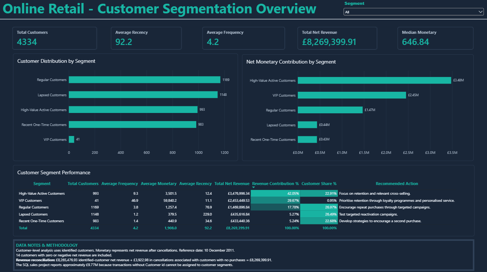
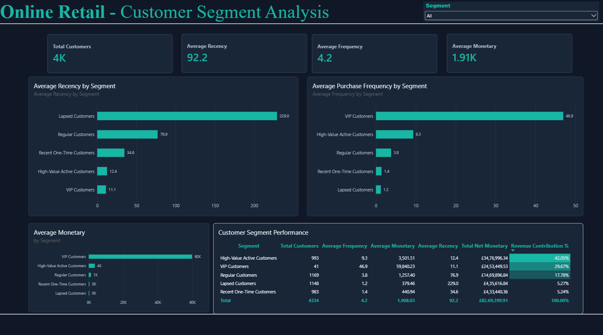

# # Online Retail Customer Segmentation

## Project Overview

This project uses RFM (Recency, Frequency, Monetary) analysis and K-Means clustering to segment customers from an online retail dataset.

The objective is to identify different customer groups based on purchasing behaviour, understand their contribution to overall monetary value, and generate actionable business insights.

The project follows an end-to-end data analysis workflow using Microsoft SQL Server, Python and Power BI.

## Business Objectives

- Identify meaningful customer segments based on purchasing behaviour.
- Understand customer recency, purchase frequency and monetary value.
- Identify high-value and potentially inactive customers.
- Analyse monetary contribution across different customer segments.
- Develop data-driven recommendations for customer retention and engagement.

## Tools and Technologies

| Tool | Purpose |
|---|---|
| Microsoft SQL Server | Data preparation, RFM calculations and validation |
| SQL / T-SQL | Data extraction, aggregation and diagnostics |
| Python | Data analysis and customer segmentation |
| Pandas & NumPy | Data manipulation |
| Scikit-learn | Data transformation, K-Means clustering and model evaluation |
| Matplotlib | Exploratory data visualisation |
| Power BI | Interactive dashboard and business reporting |
| Google Colab / Jupyter Notebook | Python development environment |

## Dataset Description

The project uses an online retail transactional dataset containing customer purchases, product details, invoice information and transaction values.

The final customer-level segmentation dataset contains **4,334 unique customers and 7 columns**.

### Final Dataset Schema

| Column Name | Data Type | Description |
|---|---|---|
| CustomerID | Integer | Unique identifier assigned to each customer |
| LastPurchaseDate | Datetime | Date and time of the customer's most recent purchase |
| Frequency | Integer | Number of distinct purchase invoices made by the customer |
| Monetary | Decimal | Customer's total monetary value based on the prepared transaction data |
| Recency | Integer | Number of days since the customer's last purchase, measured relative to the analysis reference date |
| Cluster | Integer | Cluster identifier assigned by the K-Means algorithm |
| Segment | String | Business-oriented customer segment name assigned to each cluster |

### RFM Metrics

- **Recency:** Measures how recently a customer made a purchase. Lower values indicate more recent activity.
- **Frequency:** Measures how often a customer purchases, based on distinct invoices.
- **Monetary:** Measures the customer's total monetary value based on the prepared transaction data.

These metrics provide the foundation for identifying different customer purchasing patterns.

## Project Workflow

The project follows three main stages.

### 1. SQL – Data Preparation and Validation

SQL Server was used to prepare and validate the customer-level RFM dataset.

Key activities:

- Reused existing sales views from the original [Online Retail Sales Analysis](https://github.com/yashmoily/online-retail-sales-analysis) project.
- Calculated customer purchase frequency using distinct invoices.
- Identified each customer's last purchase date.
- Calculated monetary value using the prepared sales data.
- Investigated customers with non-positive monetary values.
- Performed validation checks on the resulting RFM dataset.

**Output:** `RFM_Base.csv`

The SQL diagnostics script depends on the following views from the original SQL project:

- `dbo.vw_OnlineRetail_ProductSales`
- `dbo.vw_OnlineRetail_NetSales`

### 2. Python – RFM Analysis and Customer Segmentation

Python was used to transform the RFM dataset, perform clustering and interpret customer behaviour.

Key activities:

- Explored and validated the RFM dataset.
- Analysed Recency, Frequency and Monetary distributions.
- Applied Yeo-Johnson transformation to reduce feature skewness.
- Standardised features using StandardScaler.
- Applied K-Means clustering.
- Evaluated clustering performance and stability.
- Assigned business-oriented names to the resulting customer segments.

#### Clustering Configuration

| Parameter | Value |
|---|---|
| Algorithm | K-Means |
| Number of clusters | 5 |
| Feature transformation | Yeo-Johnson |
| Feature scaling | StandardScaler |
| Silhouette Score | 0.363 |
| Davies-Bouldin Index | 0.874 |
| Calinski-Harabasz Index | 2,626.484 |
| Average Adjusted Rand Index | Approximately 0.9975 |

The Adjusted Rand Index was calculated across six random initialisation seeds to assess clustering stability.

#### Cluster Selection Rationale

Several cluster configurations (K=2 to K=8) were evaluated using the Silhouette Score, Davies-Bouldin Index and Calinski-Harabasz Index.

Although K=2 achieved the highest Silhouette Score (0.430), K=5 was selected as a practical balance between clustering evaluation and business interpretability.

The five-cluster solution identified distinct customer groups, including a small VIP segment representing 0.95% of customers but contributing 29.67% of total monetary value.

The selection was therefore based on the usefulness and interpretability of the resulting customer segments rather than on a single evaluation metric. The K=5 solution also demonstrated high consistency across six random initialisation seeds, with an average Adjusted Rand Index of approximately 0.9975.

#### Clustering Evaluation

| Number of Clusters (K) | Silhouette Score | Davies-Bouldin Index | Calinski-Harabasz Index |
|---:|---:|---:|---:|
| 2 | 0.430 | 0.906 | 3,450.025 |
| 3 | 0.375 | 1.001 | 2,748.505 |
| 4 | 0.355 | 0.930 | 2,563.569 |
| 5 | 0.363 | 0.874 | 2,626.484 |
| 6 | 0.366 | 0.791 | 2,717.672 |
| 7 | 0.375 | 0.774 | 2,899.501 |
| 8 | 0.384 | 0.797 | 2,974.026 |

Higher Silhouette and Calinski-Harabasz scores and lower Davies-Bouldin scores generally indicate better-defined clusters.

No single configuration performed best across all metrics, so K=5 was retained based on the interpretability and business usefulness of its resulting segments.

**Output:** `RFM_Segmented.csv`

### 3. Power BI – Dashboard and Business Analysis

The Power BI dashboard consists of two interactive pages designed to explore customer segments, purchasing behaviour and monetary contribution.

#### Page 1 – Customer Segmentation Overview

- Total customers
- Average recency
- Average purchase frequency
- Total net revenue
- Median monetary value
- Customer distribution by segment
- Net revenue contribution by segment
- Customer segment performance table, including customer count, average frequency, average monetary value, average recency, total net revenue, revenue contribution, customer share and recommended actions
- Segment-based filtering

#### Page 2 – Customer Segment Analysis

- Segment-based filtering
- Total customers and average recency
- Average purchase frequency
- Average monetary value
- Median monetary value
- Average recency comparison across customer segments
- Average purchase frequency comparison across customer segments
- Average monetary value comparison across customer segments
- Customer-level scatter plot showing the relationship between recency and monetary value, segmented by customer group

**Dashboard Focus:** Customer distribution, purchasing behaviour, monetary contribution, segment performance and customer-level analysis.

### Dashboard Screenshots

#### Page 1 – Customer Segmentation Overview



#### Page 2 – Customer Segment Analysis



## Customer Segmentation Results

The final analysis identified five customer segments across 4,334 customers.

| Customer Segment | Customers | Customer Share | Monetary Contribution |
|---|---:|---:|---:|
| Regular Customers | 1,169 | 26.97% | 17.78% |
| High-Value Active Customers | 993 | 22.91% | 42.05% |
| Recent One-Time Customers | 983 | 22.68% | 5.24% |
| Lapsed Customers | 1,148 | 26.49% | 5.27% |
| VIP Customers | 41 | 0.95% | 29.67% |
| **Total** | **4,334** | **100%** | **100%** |

- **Total customers:** 4,334
- **Total monetary value:** £8,269,399.91

*Monetary contribution percentages may not add up to exactly 100% due to rounding.*

## Key Business Insights

### 1. High-Value Customers Drive Monetary Contribution

High-Value Active Customers represent approximately 22.91% of customers but contribute 42.05% of total monetary value.

This segment represents an important group for customer retention and loyalty initiatives.

### 2. VIP Customers Have a Significant Monetary Contribution

VIP Customers account for only 0.95% of the customer base but contribute 29.67% of total monetary value.

Maintaining relationships with these customers should be a business priority.

### 3. Recent One-Time Customers Present an Engagement Opportunity

Recent One-Time Customers account for 22.68% of customers but contribute only 5.24% of monetary value.

Targeted engagement and repeat-purchase campaigns could help encourage further purchases.

### 4. Lapsed Customers May Require Reactivation Strategies

Lapsed Customers represent 26.49% of customers but contribute only 5.27% of monetary value.

Reactivation campaigns and targeted offers could help assess whether these customers can be brought back.

### 5. Monetary Contribution Is Concentrated Among High-Value Segments

VIP and High-Value Active Customers together represent approximately 23.86% of customers but contribute 71.72% of total monetary value.

This highlights the importance of retaining high-value customers while developing strategies to improve the purchasing behaviour of other segments.

## Repository Structure

```text
online-retail-customer-segmentation/
│
├── 01_SQL/
│   └── 01_RFM_Data_Validation_Diagnostics.sql
│
├── 02_Python/
│   └── Online_Retail_Customer_Segmentation.ipynb
│
├── 03_PowerBI/
│   ├── Online_Retail_Customer_Segmentation.pbix
│   └── Dashboard_Screenshots/
│       ├── Page_1_Overview.png
│       └── Page_2_Analysis.png
│
├── 04_Output/
│   └── RFM_Segmented.csv
│
├── README.md
└── .gitignore
```

## How to Explore the Project

1. Review the SQL diagnostics script in `01_SQL`.
2. Open the Python notebook in `02_Python` to understand the RFM analysis, feature transformation and clustering process.
3. Review `RFM_Segmented.csv` in `04_Output` for the final customer-level segmentation results.
4. Open the Power BI file in `03_PowerBI` to explore the interactive dashboard.

**Note:** The SQL diagnostics script requires the two SQL views created in the companion Online Retail Sales Analysis project.

## Limitations and Considerations

1. **Customer identification:** Customer-level segmentation requires an identifiable CustomerID. Transactions without a CustomerID cannot be reliably assigned to individual customer segments.
2. **Monetary calculation:** Non-positive monetary values were investigated and retained rather than automatically removed. The prepared transaction data may retain limitations associated with cancellation and return handling.
3. **Clustering limitations:** K-Means is an unsupervised clustering algorithm; the resulting segments are exploratory groups, not guaranteed future customer behaviour.
4. **Segment interpretation:** Business-oriented segment names are interpretations of the resulting cluster characteristics.
5. **Model dependency:** The clustering results depend on the dataset, feature transformations and selected number of clusters.
6. **Stability testing:** The stability assessment checks different random initialisations, not changes across time periods or datasets.

## Related Project

**Online Retail Sales Analysis – SQL Server**

This companion project covers the SQL-based data preparation, transaction analysis, data quality assessment and business findings used as the foundation for this customer segmentation project.[View the companion SQL project](https://github.com/yashmoily/online-retail-sales-analysis)

## Project Focus

SQL Data Analysis | RFM Analysis | Customer Segmentation | Machine Learning | Python | Power BI Dashboard